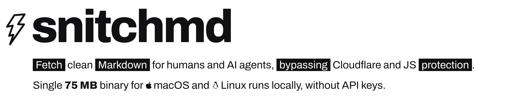

<picture>
  <source media="(prefers-color-scheme: dark)" srcset="website/hero-dark.png" />
  <source media="(prefers-color-scheme: light)" srcset="website/hero-light.png" />
  
</picture>

  
---

<picture>
  <source media="(prefers-color-scheme: dark)" srcset="website/curl-vs-snitchmd-dark.webp" />
  <source media="(prefers-color-scheme: light)" srcset="website/curl-vs-snitchmd.webp" />
  
</picture>

## Install

```sh
curl -fsSL https://raw.githubusercontent.com/syabro/snitchmd/master/install.sh | bash
```

Installs the binary to `/usr/local/bin` or `~/.local/bin` and the agent skill for Claude Code, Cursor, and Codex.

Prebuilt for macOS arm64, macOS x86_64, Linux x86_64 (glibc 2.35+), and Linux arm64 (glibc 2.38+).

Uninstall:

```sh
curl -fsSL https://raw.githubusercontent.com/syabro/snitchmd/master/install.sh | bash -s -- --uninstall
```

## Usage

```sh
# Print clean Markdown to stdout
snitchmd https://stackoverflow.com/questions/11227809

# Return JSON with title, quality score, and Markdown
snitchmd --json https://paulgraham.com/greatwork.html

# Extract a specific CSS selector instead of the whole article
snitchmd --dump-selector "table.infobox" https://en.wikipedia.org/wiki/Markdown

# Start the built-in MCP server for Claude Code, Cursor, and Codex
snitchmd mcp
```

`stderr` prints a single summary line: title, extraction quality (`0`–`1`), character count, and `(cached)` on cache hits.

**Exit codes:** `0` success; `1` error (network, browser, invalid option, or bot challenge; message on stderr); `2` no main content found (loading shell, wall, or empty page); `22` HTTP status 400 or higher.

### Options

Every `lightpanda fetch` option works (`snitchmd help fetch`). Most used:

| Flag | Description |
| --- | --- |
| `--json` | Prints `{url, final_url, title, page_title, page_type, quality, chars, markdown}` |
| `--no-cache` | Fetches again instead of answering from disk cache |
| `--html-output FILE` | Also saves the rendered HTML |
| `--include-images` | Keeps image references |
| `--favor-precision` | Cuts more boilerplate |
| `--favor-recall` | Keeps more content |
| `--dump-selector CSS` | Extracts only from the first matching element |
| `--wait-selector CSS` | Waits for an element before extracting |
| `--script JS`, `--script-file PATH` | Runs JS in the page before extracting |
| `--wait-ms N` | Wait cap in ms (default `30000`) |
| `--dump-max-bytes N` | Cuts Markdown at `N` bytes and appends `[truncated]` |
| `--http-proxy URL` | HTTP proxy |
| `--locale TAG`, `--timezone IANA` | Browser locale and time zone |
| `--dump html` | Prints rendered HTML instead of Markdown |

### Cache

A successful Markdown fetch is cached on disk by URL and options, so repeat calls return immediately.

- Not cached: errors and extractions with quality below `0.5` (login walls, 200-OK error pages); `stderr` notes `(not cached: low quality)`.
- Location: `$SNITCHMD_CACHE_DIR` or `${XDG_CACHE_HOME:-$HOME/.cache}/snitchmd`.
- `--json`, `--no-cache`, `--html-output`, and `--dump-max-bytes` do not alter the cache key.
- Refresh one URL with `--no-cache`; wipe everything with `rm -rf ~/.cache/snitchmd`.

## How it works

Built on [Lightpanda](https://github.com/lightpanda-io/browser) with patches baked into the binary:

- Safari 27.0 TLS and HTTP/2 fingerprint via [curl-impersonate](https://github.com/lexiforest/curl-impersonate)'s curl and BoringSSL patches, plus Safari User-Agent.
- Two scripts injected into every page (`src/browser/snitchmd/` in `patches/lightpanda.patch`): `safari.js` (Safari JS identity: `navigator.vendor`, no `userAgentData`) and `style-index.js` (indexed access to inline styles missing in Lightpanda, preventing crashes on React sites like Substack).
- Main content extraction via [rs-trafilatura](https://github.com/Murrough-Foley/rs-trafilatura), printing Markdown by default.
- Telemetry is off.

The previous Docker + CloakBrowser version lives on the `v1` branch (`--headful` and `--humanize` were Chromium-only and are not carried over).

## Build from source

Requires Zig 0.17, Rust (`cargo`), `git`, `curl`, and `make`.

```sh
scripts/build.sh            # fetch pinned sources, patch, build → dist/snitchmd (~8 min)
scripts/build.sh prepare    # fetch and patch into build/ without building
```

To modify Lightpanda:

```sh
just prepare    # pinned sources + patches into 3rdparty/ (not in git)
# edit 3rdparty/lightpanda
just dev        # build → dist/snitchmd
just test       # Lightpanda's tests; just test NAME filters
just patch      # write edits back to patches/lightpanda.patch, then commit that
```

Releases are built by GitHub Actions: `just release VERSION` tags and pushes, and the workflow builds macOS arm64, macOS x86_64, Linux x86_64, and Linux arm64 with notes from `CHANGELOG.md`.

Pinned versions are in `versions.env`. Patches:

- **curl:** `patches/curl.patch` (curl-impersonate, unchanged)
- **BoringSSL:** `patches/boringssl.patch` (curl-impersonate, unchanged)
- **boringssl-zig:** `patches/boringssl-zig.patch` (uses local BoringSSL; source list fixed for `BORINGSSL_REV` in `versions.env`)
- **Lightpanda:** `patches/lightpanda.patch`
